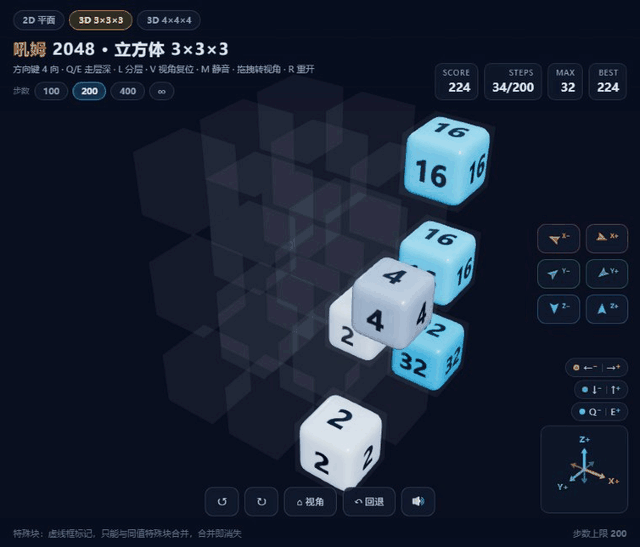
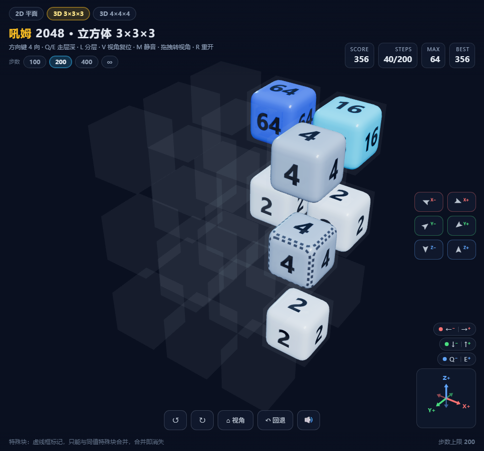
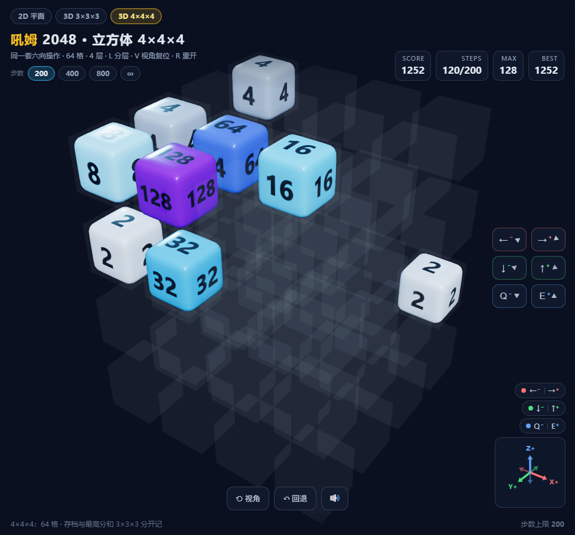
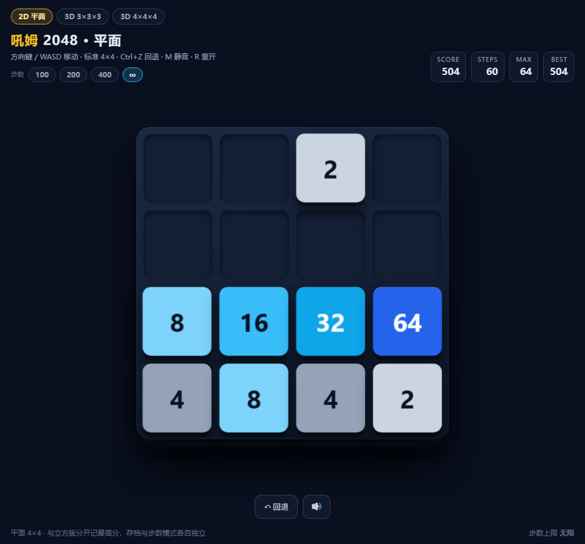
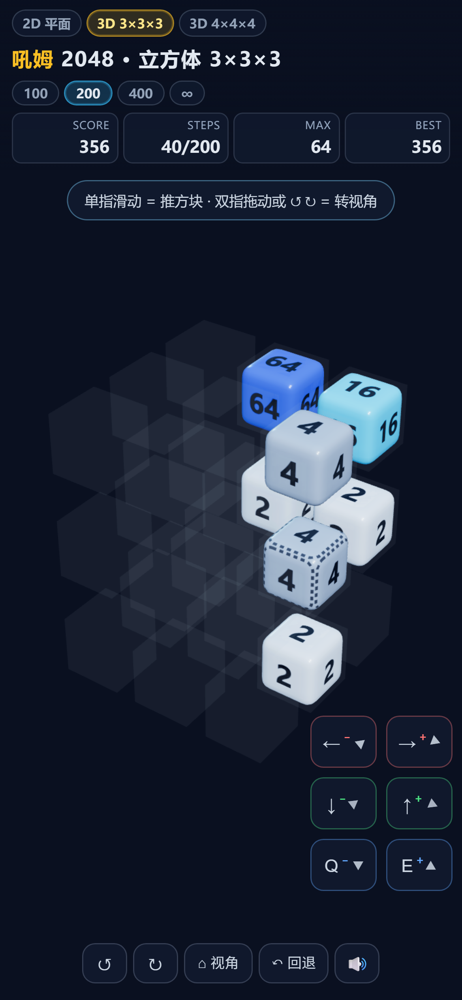
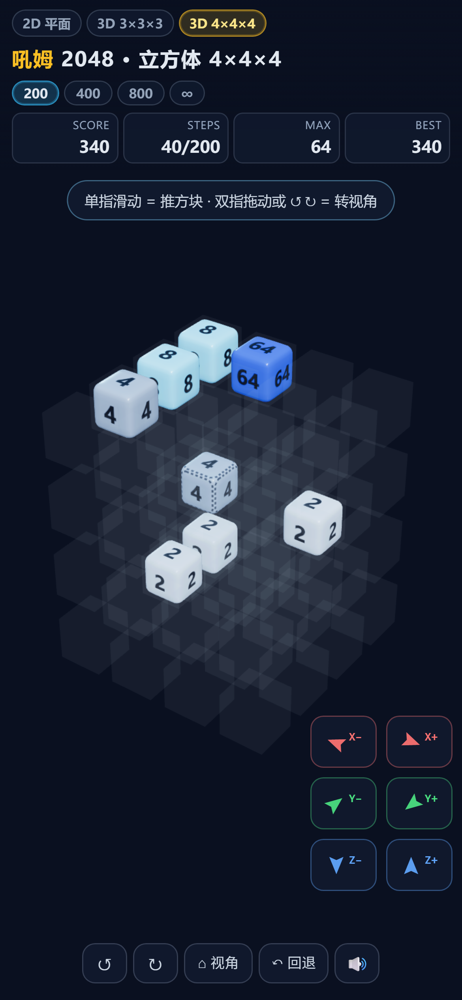
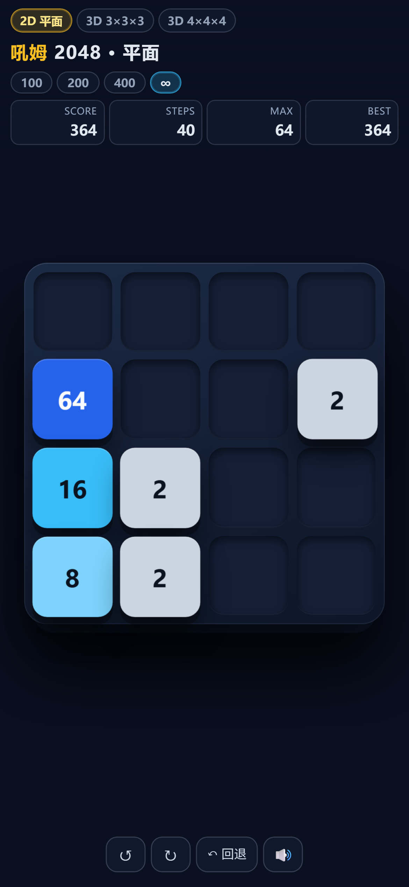

# Homu 2048 · Cube & Flat

[中文](README.md) · **English**

Three 2048 boards on one static page: **3D 3×3×3** (27 cells, six directions), **3D 4×4×4** (64 cells, same controls), and **classic 2D 4×4**. Pure static HTML — no build step, no dependencies, no network. Double-click and play.

**Play: <https://1822774284.github.io/homu-2048/>**



## The three boards

- **3D 3×3×3** — 27 cells in a cube, pushable along all six directions, layers can be pulled apart
- **3D 4×4×4** — the same rules scaled to 64 cells; blocks drop to 12 segments, ~110k triangles when full
- **2D Flat** — standard 4×4, keyboard or swipe
- Each board keeps its **own save, own best score, own move limit** — switching never overwrites the others

Switch with the pill in the top-left (`2D 平面` / `3D 3×3×3` / `3D 4×4×4`). The choice is remembered.

## Quick start

```bash
# Option 1: just open it
index.html

# Option 2: serve statically (recommended; localStorage behaves like production)
python -m http.server 8000
# then open http://localhost:8000/
```

Deploying to GitHub Pages: **Settings → Pages → Deploy from a branch → `main` / `/ (root)`**, then visit `https://<user>.github.io/<repo>/`. Static pages only, no build.

## Controls

| Action | 3D (3×3×3 / 4×4×4) | 2D Flat |
| --- | --- | --- |
| Move | ←→ on X, ↑↓ on Y (depth), Q/E on Z (layer); on mobile **one-finger swipe** (picks the closest screen direction) | ←→↑↓ or WASD, or swipe on the board |
| Cursor pads | Six buttons on the right; arrows **rotate with the camera** and point at where the block will travel on screen. When an axis faces the camera head-on the label switches to near/far. `X± / Y± / Z±` names the world axis | none (arrow keys are enough) |
| Explode / compact layers | L | — |
| Rotate camera | mouse drag / two-finger drag / bottom `↺` `↻` (tap = 20° eased, hold = continuous; Shift+←/→ too), wheel zooms | — |
| Undo | bottom `↶ 回退` or Ctrl+Z, up to 50 steps | same |
| Reset camera | bottom `⟲ 视角` or V | — |
| Sound | bottom `🔊` or M | same |
| Restart | R | R |

- The little triangle on each pad follows the camera: it points at **which way on screen that direction goes right now**; it fades out when the axis is nearly head-on
- The axis widget in the corner draws every axis as a pair of opposite arrows; the half-axis you press thickens and glows
- Undo rewinds score and step count together — **you can undo out of a dead end**
- Autosave: board, best score and history live in localStorage; `?fresh=1` starts clean

## Modes

Four buttons after "步数" (steps) under the title. **Picking one starts a new game**, so it clears the undo history.

| Board | Limits |
| --- | --- |
| 3D 3×3×3 | 100 / 200 / 400 / ∞ (default 200) |
| 3D 4×4×4 | 200 / 400 / 800 / ∞ (default 200) |
| 2D Flat | 100 / 200 / 400 / ∞ (default ∞) |

Finite modes show `used/limit` and settle at the cap; unlimited ends only when **no move is left**.

## Rules

**Cube (3D)**

- 3×3×3 has 27 cells, 4×4×4 has 64; each move spawns a 2 (90%) or 4 (10%) in a free cell
- Special blocks: 6% chance, marked with a dotted outline
  - They **never merge with normal blocks**, even at equal value — two "4"s on the board, one of them special, will not combine
  - Two **equal specials** meeting: both vanish, scoring `|v| × 2`
  - That is the same score as a normal 2+2 merge, so their value is not points — it is **freed cells**
- The step cap comes from the mode; reaching 2048 does not end the run

**Flat (2D)**

- Standard 4×4 2048: each block merges at most once per move (`4 4 4` left → `8 4`), no special blocks
- Same spawn and scoring as the cube; 2048 renders as "吼姆" (Homu)

## Screenshots

| 3×3×3 | 4×4×4 | 2D Flat |
| --- | --- | --- |
|  |  |  |

| Mobile · 3×3×3 | Mobile · 4×4×4 | Mobile · Flat |
| --- | --- | --- |
|  |  |  |

On a phone the layout changes: the title stacks, the status cards fill one row, the axis widget and pads collapse, and the six direction pads move to the bottom-right. A one-finger swipe pushes, a two-finger drag orbits. The camera is recomputed from the aspect ratio (portrait even takes the worst case over the four orientations, so rotating never crops the cube).

## How it works

- **Rules and rendering are separate**: `engine3d.js` / `engine2d.js` never touch the DOM; they return where every block came from and went to, and the animation layer only interpolates
- **Render on demand**: nothing is redrawn while idle; animation, camera moves and rebuilds set a dirty flag
- **Low poly**: empty-cell hints are one InstancedMesh; 4×4×4 blocks use 12 segments (1728 faces each) — 65 draw calls, ~110k triangles when full
- **Solver**: two-ply lookahead for 3D (play a move → assume a new tile in every empty cell → evaluate one more move), scored by a mean/worst-case blend; median 2580 over 20 runs × 200 moves
- **Audio**: everything synthesized with Web Audio — zero audio files

Deeper notes, the reason behind every fix and the measurements live in [docs/DEVELOPMENT.md](docs/DEVELOPMENT.md) (Chinese).

## Development & verification

```bash
# rule-layer self-tests (13 assertions each)
node engine3d.js test
node engine2d.js

# offline solver benchmark: 20 fixed seeds, played to the cap
node bench-solver.mjs 200          # 3×3×3
N=4 node bench-solver.mjs 400      # 4×4×4

# headless interaction regression: real keys, clicks and drags, 38 assertions
node probe-cdp.mjs                 # needs Chrome or Edge; set EDGE=<path> to pick one
```

Debug parameters (`?seed=`, `?sim=`, `?debug=`, `?bot=`, `?ghostmode=` …) are documented in the [dev notes](docs/DEVELOPMENT.md#调试).

## Browser support

WebGL required (any recent Chrome / Edge / Firefox / Safari). The flat board supports swipes on mobile; the cube uses the six direction pads.

## License

[MIT](LICENSE). The bundled three.js r160 is MIT as well — see `vendor/three.min.js` and the third-party notice in LICENSE.

## Disclaimer

An unofficial fan project, not affiliated with miHoYo. "Homu" and related characters and designs belong to miHoYo / HoYoverse. This project is for learning and fun, not for commercial use.
