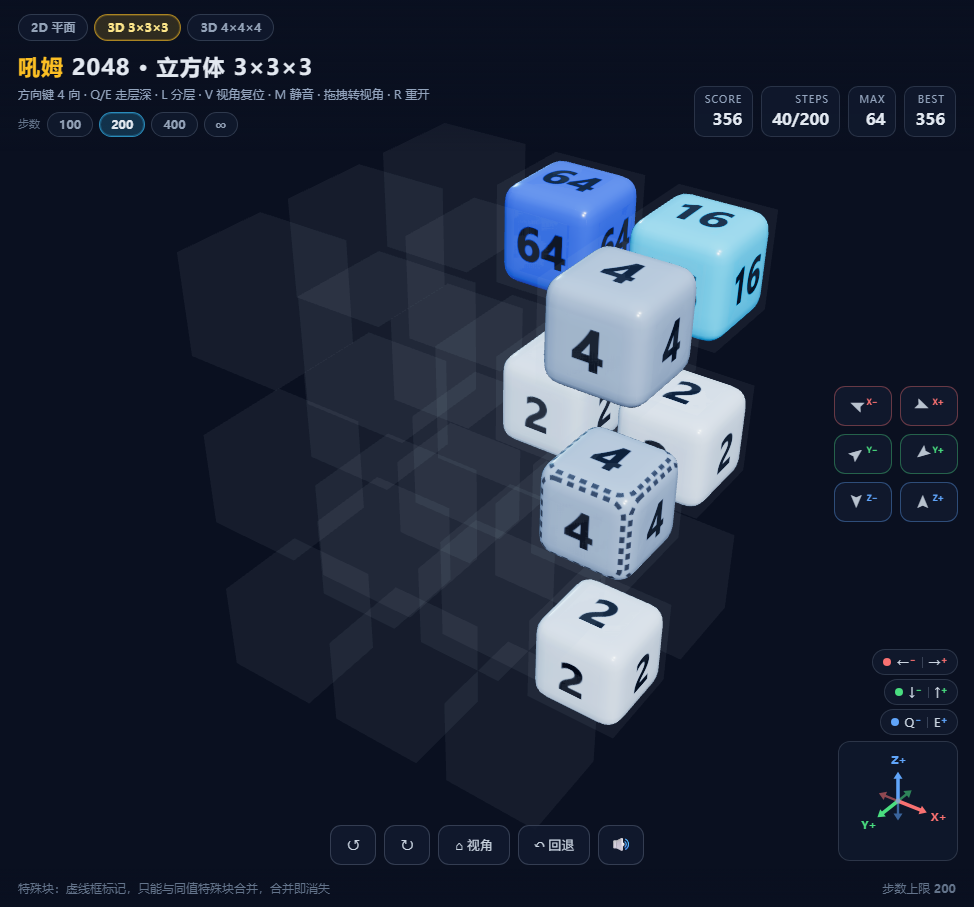
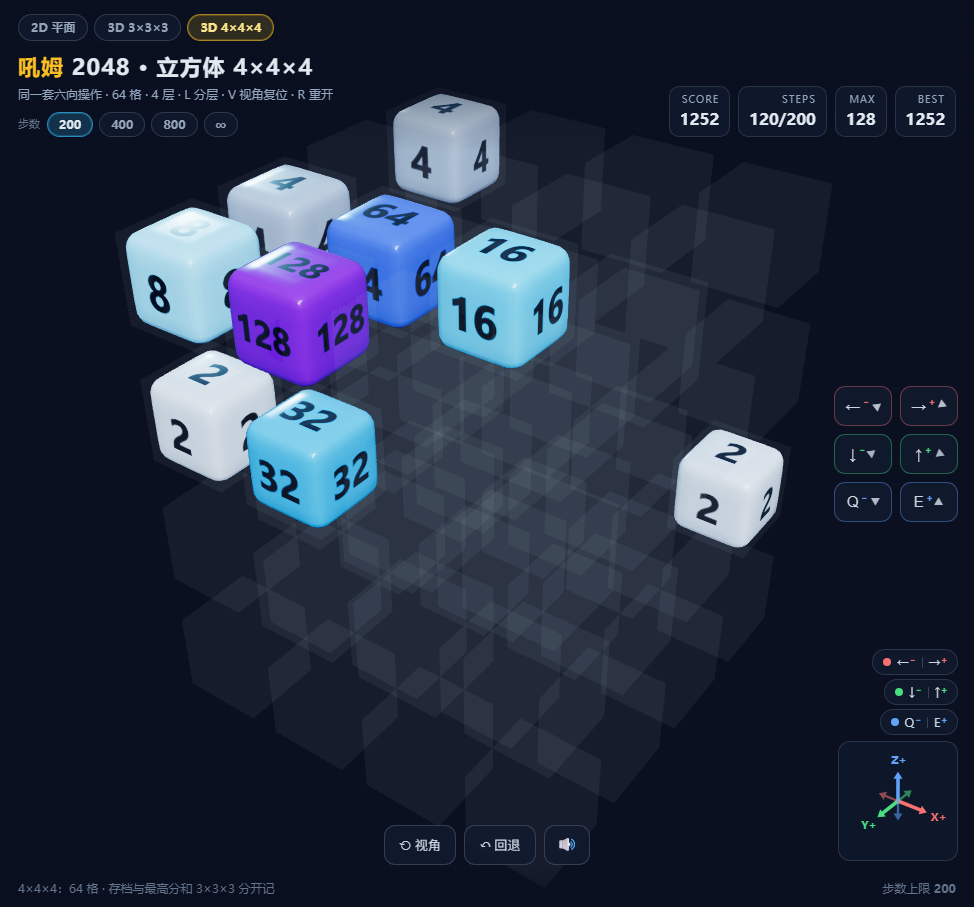
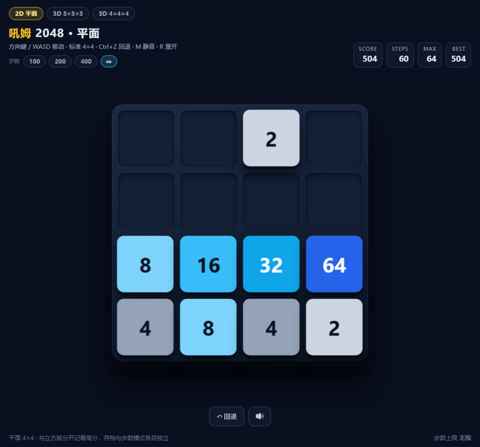
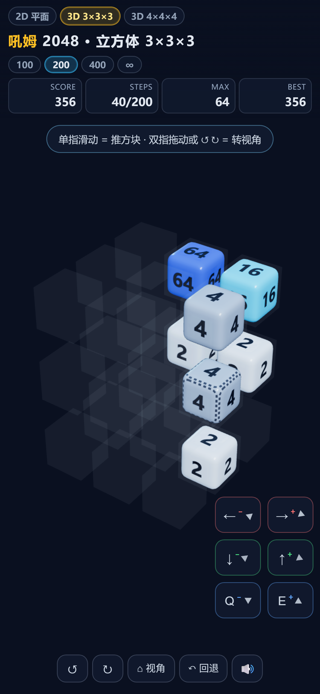
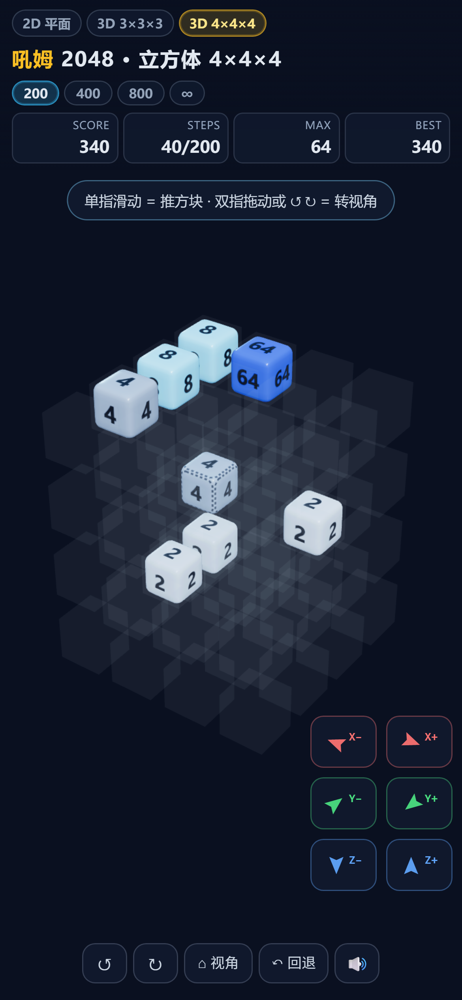
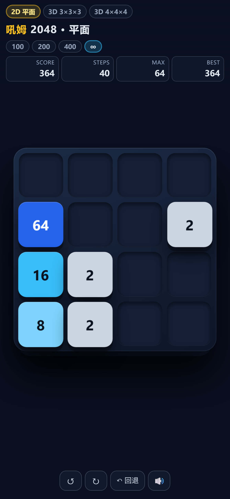

# 吼姆 2048 · 立方体 / 平面

在同一个页面里放三套 2048：**3D 3×3×3**（27 格、六个方向）、**3D 4×4×4**（64 格、同一套操作）、**2D 平面**（经典 4×4）。纯静态网页，无构建步骤、无外部依赖，双击就能玩。

> 2048 in 3D — three boards (3×3×3, 4×4×4, and classic 4×4) in one static page. No build step, no network.



## 三套棋盘

- **3D 3×3×3**：27 个格位在三维里排布，六条方向都能推，四层可拆开看
- **3D 4×4×4**：同一套规则放大到 64 格；方块分段降到 12，满盘约 11 万三角形
- **2D 平面**：标准 4×4，键盘、滑动都能玩
- 三套棋盘**各自独立存档、各自记最高分、各自记步数档位**，切换不会互相覆盖

左上角胶囊切换（`2D 平面` / `3D 3×3×3` / `3D 4×4×4`），选择会被记住。

## 快速开始

```bash
# 方式一：直接双击
index.html

# 方式二：起个静态服务器（推荐，localStorage 行为与线上一致）
python -m http.server 8000
# 打开 http://localhost:8000/
```

部署到 GitHub Pages：仓库 **Settings → Pages → Deploy from a branch → `main` / `/ (root)`**，之后访问 `https://<用户名>.github.io/<仓库名>/`。纯静态页面，不需要任何构建。

## 操作

| 操作 | 3D（3×3×3 / 4×4×4） | 2D 平面 |
| --- | --- | --- |
| 移动 | ←→ 走 X 轴、↑↓ 走 Y 轴（纵深）、Q/E 走 Z 轴（层深）；手机上是**单指滑动**（按屏幕上最接近的方向） | ←→↑↓ 或 WASD，或在棋盘上滑动 |
| 光标移动 | 右侧中部六个按钮，与键盘同一套世界轴 | 无（方向键即可） |
| 分层 / 紧凑 | L | — |
| 转动视角 | 鼠标拖动 / 双指拖动 / 底部 `↺` `↻`（点一下转 20° 带缓动，按住连续转；Shift+←/→ 同效），滚轮缩放 | — |
| 回退一步 | 底部 `↶ 回退` 或 Ctrl+Z，最多 50 步 | 同左 |
| 视角复位 | 底部 `⟲ 视角` 或 V | — |
| 音效开关 | 底部 `🔊` 或 M | 同左 |
| 重开 | R | R |

- 按钮右侧的小三角会跟着机位转，直接指向**这个方向在当前视角下往屏幕哪边走**；轴几乎正对镜头时自动隐去
- 右下角坐标轴每条轴都画成一对相反的箭头，按键时对应那条半轴会加粗发光
- 回退会同时退回步数与分数；**死局也能靠回退救回来**
- 自动存档：局面与最高分存在 localStorage，关掉再开接着玩（`?fresh=1` 直接开新局）

## 模式

标题下面“步数”后面四个按钮。**选了就开新局**，所以换档位会清空回退历史。

| 棋盘 | 档位 |
| --- | --- |
| 3D 3×3×3 | 100 / 200 / 400 / ∞（默认 200） |
| 3D 4×4×4 | 200 / 400 / 800 / ∞（默认 200） |
| 2D 平面 | 100 / 200 / 400 / ∞（默认 ∞） |

有限模式显示 `已用/上限`，走满即结算；无限模式只有**无路可走**才结束。

## 规则

**立方版（3D）**

- 3×3×3 共 27 格、4×4×4 共 64 格；每步在空格随机生成一个 2（90%）或 4（10%）
- 特殊块：6% 概率生成，虚线框标记
  - 它**不与普通块合并**，哪怕数值相同——盘上两个“4”里有一个是特殊的，推到一起也不动
  - 两个**同值特殊块**相遇：两块一起消失，按 `|v| × 2` 计分
  - 这分数和普通 2+2 合并一样多，所以它的价值不在分，在**一次腾出两格**
- 步数上限看档位；达成 2048 不结束，继续可往上叠

**平面版（2D）**

- 标准 4×4 2048：一步里每个块只合一次（`4 4 4` 向左 → `8 4`），没有特殊块
- 发牌与计分同立方版；2048 显示成“吼姆”

## 截图

| 3×3×3 | 4×4×4 | 2D 平面 |
| --- | --- | --- |
|  |  |  |

## 技术要点

- **规则与渲染分离**：`engine3d.js` / `engine2d.js` 不碰 DOM，额外返回每个方块的来处与去处，动画层只负责插值
- **按需渲染**：静止时不重绘（`renders` 不再增长），动画、相机、重建时才打脏标记
- **省面数**：空格提示合并成一个 InstancedMesh；4×4×4 的方块分段降到 12（1728 面/块），满盘 65 draw / 约 11 万三角形
- **求解器**：3D 用两段前瞻（走一步 → 枚举每个空格长出新块 → 再算一步），取“均值 + 最坏”折中；200 步 20 局中位 2580 分
- **音效**：全部 Web Audio 现场合成，零音频文件

更细的实现说明、每一次修复的原因和实测数据都在 [docs/DEVELOPMENT.md](docs/DEVELOPMENT.md)。

## 开发与验证

```bash
# 规则层自检（各 13 项）
node engine3d.js test
node engine2d.js

# 求解器离线评测：20 个固定种子跑满步数
node bench-solver.mjs 200          # 3×3×3
N=4 node bench-solver.mjs 400      # 4×4×4

# 无头交互回归：真按键 / 真点击 / 真拖动，38 项断言
node probe-cdp.mjs                 # 需要本机有 Chrome 或 Edge，可用 EDGE=<路径> 指定
```

调试参数（`?seed=`、`?sim=`、`?debug=`、`?bot=`、`?ghostmode=` 等）见 [开发笔记](docs/DEVELOPMENT.md#调试)。

## 浏览器支持

需要 WebGL（Chrome / Edge / Firefox / Safari 近两年版本均可）。移动端：平面版支持滑动手势，立方版用右侧六个方向按钮。

手机上是另一套布局与操作：标题栏收成竖排、状态卡铺满一行、坐标轴与轴徽章收起、六个方向按钮放大挪到右下；
立方体**单指滑动 = 推方块**（取屏幕上最接近的那个世界方向）、**双指拖动 = 转视角**；
机位按屏幕比例自动重算（竖屏还会对四个朝向取最坏值，转视角也不会顶出屏幕）。

| 手机 · 3×3×3 | 手机 · 4×4×4 | 手机 · 平面 |
| --- | --- | --- |
|  |  |  |

## 许可

[MIT](LICENSE)。内置的 three.js r160 同样是 MIT，见 `vendor/three.min.js` 与 LICENSE 中的第三方声明。

## 声明

非官方同人作品，与 miHoYo 无关。「吼姆」及相关角色、形象的权利归米哈游（miHoYo）所有。
本项目仅用于学习与娱乐，不用于商业用途。
